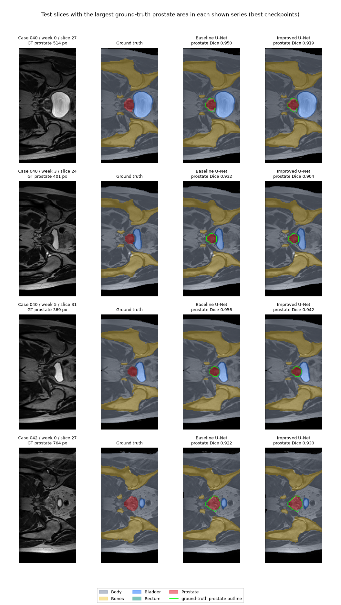
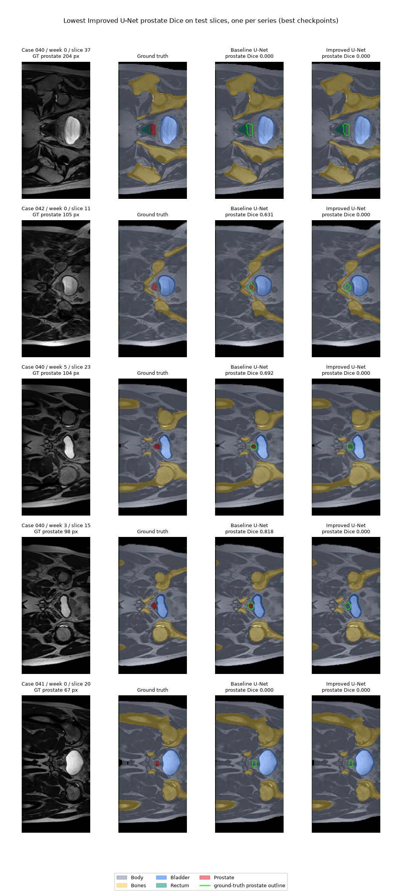

# HipMRI 2D Improved U-Net - Panupong

COMP3710 individual project: compare a standard 2D U-Net baseline with the course-specified 2D Improved U-Net on HipMRI. The selected difficulty is Normal.

## Current development status

- Project planning and the initial feasibility review have been prepared.
- VS Code execution through Google Colab was verified using PyTorch CUDA tensor arithmetic on a Tesla T4.
- Independent online research identified **stored value 5 as Prostate** in the official CSIRO dataset documentation. All 60 processed masks for Case 006 / Week 0 preserve the original numeric labels in a direct array comparison. This finding was not obtained from or confirmed by a tutor; other series have not been individually matched to original 3D masks.
- `dataset.py`, `modules.py`, `metrics.py`, `train.py` and `predict.py` are implemented. The data pipeline was checked on CPU against the full dataset audit. The models were first checked with random tensors (output shapes, gradients, loss range) and then in short real-data timing runs (below).
- Both models completed short real-data timing runs on a Colab Tesla T4 (100 training batches each, followed by validation). These remain timing evidence only.
- Final training moved to the UQ Rangpur cluster. The data pipeline passed its full check there.
- Both models completed 40 epochs of training on the same Rangpur node (NVIDIA A100-PCIE-40GB). Validation results are below.
- Both models were tested once on the test split, using the best-validation and last checkpoints fixed before training. **Both exceed the target prostate test Dice of 0.75** (results below).
- `predict.py` was run on Rangpur. It reproduced the test Dice of both models and produced the prediction figures, failure cases and inference times below.
- A boundary analysis (HD95, results by position in the gland, and leakage into neighbouring organs) addresses the HipMRI open research dilemma for the two 2D models (3D context was not tested) and leads to an engineering recommendation (below).

## Feasibility review (compulsory check-off document)

This is the one-page feasibility review presented to the tutor at the compulsory check-off. The check-off was completed by 11 October 2026. The text below is the 7 October 2026 version. It is reproduced unchanged except for four things: its title line ("COMP3710: HipMRI 2D Segmentation") is replaced by this heading, the student number is omitted from the header line, and the heading levels and link formatting were adapted for this README. Reference [1] is the version of the assignment specification that was current at the time. It was written before any model was trained, so its open questions and plans are as they stood then. The outcome of each acceptance criterion is given after it.

**One-page feasibility review - DRAFT for tutor consultation**

Student: Panupong Pakwiset | Date: 7 October 2026 | Difficulty: Normal

### 1. User need, scope and acceptance criteria

The intended user is an imaging specialist reviewing proposed prostate contours. This educational prototype will compare standard 2D U-Net with 2D Improved U-Net on HipMRI. The engineering question is whether the improved 2D architecture reduces missed tissue and boundary leakage enough to justify its computational cost. Global Dice will be considered alongside boundary errors. Proposed acceptance criteria are:

1. **Data integrity:** preserve supplied splits; verify patient grouping across visits, readable image-mask pairs, spatial alignment and confirmed anatomical label IDs before modelling.
2. **Accuracy:** target prostate test Dice >= 0.75; report per-class Dice/IoU using an explicit aggregation and empty-mask policy fixed before final evaluation.
3. **Fair comparison:** evaluate both models on identical held-out data with matched preprocessing and a documented training budget; select settings using validation only.
4. **Failure analysis:** compare input, ground truth and both models' predictions for 3-5 low-performing cases. Quantify missed/extra prostate pixels, investigate causes such as small targets, unclear boundaries or annotation uncertainty, and distinguish recurring limitations from isolated errors. Inspect base/apex cases only when anatomical ordering is verified.
5. **Resources:** aim for peak training VRAM <= 12 GiB on one Colab T4; measure parameter count, peak VRAM and inference time for both models. This is a proposed limit, not measured usage.

### 2. Model choice and course concepts

Use HipMRI Nifti slices with the supplied train/validation/test allocation. Standard 2D U-Net [2] is the baseline. The Normal-level model will be a documented 2D adaptation of Isensee et al. [3], retaining residual context blocks, instance normalization and multi-scale segmentation outputs (deep supervision). Confirm this adaptation with the tutor because the reference architecture is 3D. Skip connections preserve spatial detail, residual connections support gradient flow, and Dice-based optimization addresses class imbalance. The paper's qualitative analysis links some errors to poorly defined labels, motivating inspection of annotation uncertainty in our own results rather than attributing every error to the architecture. Normalize image intensities and apply paired augmentation; class channels depend on the complete label audit.

### 3. Preliminary feasibility evidence

Local file counts are 11,460 training, 660 validation and 540 test image-mask pairs. The earlier filename audit recorded no missing counterparts or overlapping case IDs between splits; patient grouping across visits still requires verification. A saved inspection of one training pair shows matching 256 x 128 shapes and affines, finite values, and mask IDs 0-3; anatomical meanings and the complete label set remain unknown. Saved outputs from the 4 October VS Code/Colab check show successful PyTorch CUDA tensor arithmetic on a Tesla T4. This verifies GPU access, not model feasibility. No segmentation model, training run, benchmark or measured model memory exists yet.

### 4. Risks, budget, next experiment and fallback

Main risks are unknown prostate mapping, class imbalance, ambiguous boundaries, patient leakage and Colab interruptions. Confirm processed 2D label IDs with the tutor, audit grouping and labels, and store checkpoints/results persistently outside temporary runtime storage. A provisional budget is one T4 and at most 6 GPU-hours for the initial two-model comparison; revise this after measuring epoch time. The repository is set up. Next: complete the data audit, build the data loader and inspect a batch. After label confirmation, run a brief baseline smoke test before longer experiments. If memory is insufficient, reduce batch size first. If Improved U-Net remains infeasible, retain the standard 2D baseline and discuss an Easy-level scope with the tutor. Recommend the improved model only if measured boundary-error reduction justifies its additional memory and inference cost; otherwise recommend the baseline and explain the trade-off.

### References

[1] COMP3710 Report draft v2.2, Sections 2.2 and 3 (pp. 5-6, 11-12).

[2] Ronneberger et al. (2015), *U-Net: Convolutional Networks for Biomedical Image Segmentation*. <https://arxiv.org/abs/1505.04597>

[3] Isensee et al. (2018), *Brain Tumor Segmentation and Radiomics Survival Prediction: Contribution to the BRATS 2017 Challenge*. <https://arxiv.org/abs/1802.10508>

### Outcome of the review (updated 22 October 2026)

| Acceptance criterion | Outcome |
| --- | --- |
| 1. Data integrity | Met, with limits. The supplied splits were kept, and filename case IDs are disjoint across splits (31 / 4 / 3 cases). A full audit read all 12,660 image-mask pairs and found them readable, with matching shapes and affines. Label 5 = prostate was confirmed from the dataset publisher's documentation and a direct check of one series ([LABEL_MAPPING.md](LABEL_MAPPING.md)); this was found by independent research, not confirmed by the tutor. Patient identity beyond the filename case IDs cannot be verified. |
| 2. Accuracy | Met. Test prostate Dice (per-series 3D mean) is 0.8858 for the baseline and 0.8738 for the Improved U-Net. Per-class Dice/IoU are reported, and the aggregation and empty-mask rules were fixed before training. |
| 3. Fair comparison | Met. Both models used the same splits, preprocessing, loss, optimiser, 40-epoch budget, seed and GPU type. Checkpoints were chosen on validation only. Test metrics were computed once; the later `predict.py` runs only reproduce them, draw figures and add analysis, with nothing selected or tuned. |
| 4. Failure analysis | Largely met. Five failure cases are shown, and small targets at the ends of the gland are identified as the recurring limitation. The Improved U-Net predicts no prostate on these slices, so all their prostate pixels are missed. Missed and extra prostate pixels are quantified by class, with HD95 and results by distance from the ends of the gland, in the boundary-analysis section. Annotation uncertainty was not assessed. The spacing has no known units and the physical orientation cannot be verified, so the condition for naming base or apex is not met; the cases are described as the two ends of the prostate's slice range instead. |
| 5. Resources | Met. Peak training memory was 2.32 GiB (baseline) and 0.96 GiB (Improved) on the A100, and 4.85 / 0.92 GiB in the Colab T4 timing runs, all below 12 GiB. Parameter counts and inference times were measured. |

Changes from the plan:

- **Platform:** final training moved from Colab T4 to the course's Rangpur cluster (A100). Training plus validation took 20.4 min (baseline) and 17.1 min (Improved) for 40 epochs. The job wall times were 29 and 19 min, well inside the 6 GPU-hour budget.
- **Risks resolved:** the prostate label mapping was resolved from the publisher's documentation. The pre-specified switch to a Dice plus cross-entropy loss was not needed, and the Improved U-Net was feasible, so the Easy-level fallback was not used.
- **Open question:** the review asks whether the Improved U-Net reduces missed tissue and boundary leakage enough to justify its cost. It does not reduce missed tissue: it misses the prostate on 22 slices against 17, all near the ends of the gland. Leakage into the rectum or bladder is below 1% for both models. The Improved U-Net is also cheaper, not more expensive, except for single-slice latency, so the expected trade-off does not arise. Details and the recommendation are in the boundary-analysis section below.

## Progress update: boundary analysis and the open research dilemma (22 October 2026)

The HipMRI dilemma in the assignment asks whether a good global Dice hides failures at the base and apex slices, or leakage into the rectum or bladder. It also asks whether more spatial context removes these errors or only improves easy central slices. To answer this for the two 2D models, a boundary analysis was added to `predict.py`. It was run on Rangpur as job 685882 (node `a100-8`, NVIDIA A100-PCIE-40GB, code at commit `65b1b63`, 1 min 5 s) with the same validation-selected checkpoints. The user ran the job and copied the outputs back.

The run reproduced the saved test Dice (0.8858 and 0.8738) and the same five failure cases. Its comparison and failure figures are byte-identical to those of job 685612, so the displayed slices were predicted identically. Elsewhere in the test split a few pixels differed: the recomputed baseline Dice differs from job 685612 in the sixth decimal place, which is consistent with non-deterministic GPU arithmetic. Its inference times differed from job 685612 by at most about 4%. The inference table in the predictions section below keeps the job 685612 values, and the boundary results here come from job 685882.

**Method.** HD95 is in pixels and position in the gland is counted in slices, because the NIfTI spacing ([1, 1]) has no known units.

- **HD95 per slice:** the 95th-percentile Hausdorff distance between the predicted and ground-truth prostate boundaries. It is computed on every test slice where both contain prostate.
- **Position in the gland:** each prostate slice is grouped by its distance, in slices, from the nearest end of its series' prostate slice range: 0, 1, 2, or 3 and more. The two ends cannot be labelled base or apex, because the physical orientation of the slices is not verifiable.
- **Leakage:** the true classes of all predicted prostate pixels, and the predicted classes of all true prostate pixels, over the whole test split.

**Results by position in the gland** (195 test slices with prostate; 9 series, so 18 slices at each distance 0, 1 and 2):

| Slices from the nearest end | Slices | Mean slice Dice (baseline / Improved) | Slices with no prostate predicted (baseline / Improved) | Median HD95 in px (baseline / Improved) |
| --- | ---: | --- | --- | --- |
| 0 (end slice) | 18 | 0.154 / 0.156 | 12 / 12 | 4.00 / 4.24 |
| 1 | 18 | 0.457 / 0.308 | 5 / 8 | 3.00 / 4.33 |
| 2 | 18 | 0.754 / 0.655 | 0 / 2 | 2.02 / 3.00 |
| 3 or more (central) | 141 | 0.899 / 0.887 | 0 / 0 | 2.00 / 2.17 |
| All prostate slices | 195 | 0.776 / 0.745 | 17 / 22 | 2.06 / 2.24 |

HD95 is defined only on slices where a prostate was predicted. For example, at distance 0 it covers 6 of the 18 slices for each model.

**Leakage** (prostate pixels pooled over all 540 test slices; each block sums to 100%):

| Measurement | Baseline U-Net | Improved U-Net |
| --- | ---: | ---: |
| Predicted prostate pixels that are truly prostate | 88.8% | 88.1% |
| ... that are truly body tissue | 10.3% | 11.2% |
| ... that are truly bladder | 0.85% | 0.73% |
| ... that are truly rectum | 0.07% | 0.00% |
| True prostate pixels predicted as prostate | 87.7% | 86.5% |
| ... predicted as body tissue | 11.8% | 13.1% |
| ... predicted as rectum | 0.45% | 0.23% |
| ... predicted as bladder | 0.02% | 0.14% |

**Findings.**

- **Global Dice hides the end-slice failures.** On the 141 central slices, both models reach a mean slice Dice of about 0.89-0.90, never miss the prostate, and have a median HD95 of about 2 pixels. On the 18 end slices, the mean slice Dice is about 0.15, and both models miss the prostate entirely on 12 of them. Every slice where the prostate is missed lies within 2 slices of an end of the gland. These slices hold few prostate pixels, so they barely lower the per-series 3D Dice (0.87-0.89). This is the failure mode described in the dilemma.
- **Neither 2D model fixes the ends, and the Improved U-Net does not help there.** It is about equal to the baseline on the end slice and worse one and two slices in: mean Dice 0.31 against 0.46 and 0.66 against 0.75, with 8 against 5 and 2 against 0 missed slices. On central slices the two models are almost the same.
  - This is not a test of more spatial context. Both models see the same single slice and both downsample four times. The Improved U-Net changes several things at once: residual context modules, deep supervision, instance normalisation, leaky ReLU and about 10 times fewer parameters. So the result cannot say which change causes the near-end gap.
  - Each group has only 18 slices from 3 patients (14 of them from case 040), and each model was trained once. The near-end gap is an observation, not a tested difference.
- **Leakage into the rectum and bladder is very small overall.** Pooled over all test slices, less than 1% of predicted prostate pixels are truly bladder or rectum for either model. Less than 0.5% of true prostate pixels are given to the rectum or bladder.
  - Most misclassified prostate pixels involve the surrounding body tissue. About 10-11% of predicted prostate pixels are truly body, and 12-13% of true prostate pixels are predicted as body. The latter includes the slices where the prostate is missed entirely.
  - The central slices dominate these pooled figures, so leakage on the end slices is not measured separately. On the largest miss (Figure 2, first row), part of the gland is labelled rectum.
- **Physical scale is unknown.** With unknown spacing, a median HD95 of 2 pixels cannot be converted to millimetres or compared with clinical margins.

**Answer to the dilemma, and recommendation for the project manager.**

- **Scope of the answer:** only 2D models were compared, so whether more spatial context (dilated multi-scale networks or true 3D) removes the end-slice failures is not tested here. The evidence is that the failures are confined to the ends of the gland, where a single 2D slice shows very little prostate. Within 2D, the Improved U-Net does not fix them: it is close to the baseline on central slices and worse near the ends.
- **Accuracy:** the baseline 2D U-Net is slightly better: test prostate Dice 0.8858 against 0.8738, and fewer misses near the ends of the gland.
- **Resources:** the Improved U-Net is far cheaper.
  - It has about 10 times fewer parameters and uses about 60% less training memory.
  - At batch size 16 it takes about 27% less time per slice (0.46 against 0.63 ms).
  - On single slices it is about 2.4 times slower (7.5 against 3.1 ms per slice).
- **Recommendation:**
  - Where GPU memory allows, use the baseline 2D U-Net for accuracy.
  - Choose the Improved U-Net only when memory or batched throughput is the binding constraint.
  - With either model, a contouring pipeline should send the outermost predicted prostate slice at each end, and the two to three slices beyond it, for manual review. Both models miss the true outermost slice in 12 of 18 cases, and every missed slice is within 2 slices of a true end (within 1 for the baseline). How far the predicted range falls short of the true range was not measured, so this margin should be checked before use.
- **Next experiment:** add inter-slice context, either as neighbouring slices given as extra input channels (2.5D) or as a 3D model. Evaluate it with the same distance-from-end breakdown and HD95, together with the measured memory cost, to see whether it fixes the end-slice failures that the 2D models share.

## Progress update: predictions, failure cases and inference time (22 October 2026)

`predict.py` was run once on Rangpur (job 685612, node `a100-4`, NVIDIA A100-PCIE-40GB, code at commit `b7d4fba`, 1 min 7 s). It reloaded the validation-selected checkpoints and the test split. The user ran the job and copied the outputs back.

**Consistency check.** The test prostate Dice recomputed by `predict.py` was 0.8858 for the baseline and 0.8738 for the Improved U-Net. These agree with the values saved by `train.py` when rounded to four decimal places. The absolute differences are about 0.00001: 8e-6 for the baseline and 1.5e-5 for the Improved U-Net. This indicates that the reloaded models and the preprocessing match the test evaluation. The tiny difference is consistent with non-deterministic GPU arithmetic: `cudnn.benchmark` is on, mixed precision is used, and this run was on a different A100 node (`a100-4` rather than `a100-5`). This cause was not tested separately.

**Inference time** (forward passes only, mixed precision, test images already on the GPU, median of 5 passes over the 540 test slices after one warm-up pass):

| Measurement | Baseline U-Net | Improved U-Net |
| --- | ---: | ---: |
| Batch size 1: ms per slice | 3.06 | 7.46 |
| Batch size 16: ms per slice | 0.63 | 0.46 |
| Batch size 16: slices per second | 1,593 | 2,180 |
| Peak GPU memory, batch size 16 (GiB) | 0.62 | 0.26 |

The peak memory includes the model weights and the 540 test images held on the GPU (about 0.07 GiB).

- At batch size 16, the Improved U-Net is about 27% faster per slice and uses less than half the memory.
- At batch size 1, it is about 2.4 times slower. A likely reason is that it has more, but much smaller, layers: 29 convolutions and 91 registered layer modules in total, against 23 and 61 for the baseline. With one small slice at a time, the fixed cost of launching each GPU operation probably outweighs the arithmetic. This explanation was not measured separately.
- Both models segment a slice in a few milliseconds or less on this GPU.

**Visual comparison** (Figure 1). For each of 4 test series, spread evenly over the sorted series, the figure shows the slice with the largest ground-truth prostate. The columns are the MRI, the ground truth and the two predictions. The thin bright-green (lime) line on the two prediction columns is the ground-truth prostate outline; the darker green-teal fill is the rectum. On these slices, both models outline the prostate, bladder and bones closely: prostate Dice is 0.92-0.96 for the baseline and 0.90-0.94 for the Improved U-Net.



**Failure cases** (Figure 2). The figure shows the prostate-containing test slices with the lowest Improved U-Net prostate Dice, at most one per series. Ties go to the larger ground-truth prostate. These slices were picked only for display, after all results were final.



| Series / slice | Ground-truth prostate (pixels) | Baseline Dice | Improved Dice | Position in the prostate's slice range |
| --- | ---: | ---: | ---: | --- |
| 040 / week 0 / 37 | 204 | 0.000 | 0.000 | 1 slice from the last prostate slice (16-38) |
| 042 / week 0 / 11 | 105 | 0.631 | 0.000 | 2 slices from the first prostate slice (9-40) |
| 040 / week 5 / 23 | 104 | 0.692 | 0.000 | 1 slice from the first prostate slice (22-41) |
| 040 / week 3 / 15 | 98 | 0.818 | 0.000 | 2 slices from the first prostate slice (13-32) |
| 041 / week 0 / 20 | 67 | 0.000 | 0.000 | 1 slice from the first prostate slice (19-40) |

What the failures show:

- **All failures are at the ends of the prostate.** All five shown slices, and all 22 test slices where the Improved U-Net scores 0, lie within 2 slices of the first or last slice that contains prostate. The prostate is small there (67-204 pixels in the figure, against a median of 327 over all prostate slices). No zero-Dice slice is in the middle of the gland.
- **Missed, not displaced.** On all five slices, the Improved U-Net predicts no prostate pixels at all, so these are missed detections, not shifted outlines.
- **The baseline finds some of them.** It detects the prostate on 3 of the 5 slices (Dice 0.63-0.82), which agrees with its higher slice-level Dice (0.7758 against 0.7446). Both models miss the other 2.
- **The neighbouring organs are still found.** On the largest miss (040 / week 0 / 37, Figure 2, first row), both models still segment the rectum and the bladder near the prostate, and neither predicts any prostate. Judged from the figure, the rectum prediction extends into the side of the prostate that touches the rectum (roughly a quarter to a third of it). The rest of the thin prostate strip is labelled as body. On this slice, the models find the anatomy around the prostate but do not separate the thin end of the gland from the rectum and the tissue next to it.
- **Why the 3D Dice stays high.** These edge slices contain few prostate pixels in total, so they lower the per-series 3D Dice only a little. This is why the 3D Dice stays above 0.85 while the slice-level mean is lower.

## Progress update: test results (22 October 2026)

Each model was evaluated in a single test run, after 40 epochs of training and after its training curves had been reviewed. The run scored the two checkpoints fixed before training: the best-validation checkpoint and the last-epoch checkpoint. The runs used `train.py --resume --test` on Rangpur node `a100-5` (NVIDIA A100-PCIE-40GB), with code at commit `92f51d4`: job 683766 for the baseline and job 683765 for the Improved U-Net. The user ran the jobs and copied back the logs and `test_metrics_*.json` files, and the values below come from those files.

The test split has 540 slices from 9 case/week series of 3 cases (040-042). Prostate appears in 195 slices and in every series.

**Primary result.** The checkpoint for each model was chosen beforehand: the epoch with the best validation prostate Dice. The primary metric is the 3D prostate Dice per series, averaged over the 9 series.

| Test measurement | Baseline U-Net | Improved U-Net |
| --- | ---: | ---: |
| Checkpoint epoch (best on validation) | 28 | 34 |
| **Prostate Dice, per-series mean (primary)** | **0.8858** | **0.8738** |
| Target prostate Dice >= 0.75 | met | met |
| Prostate Dice, case-weighted mean | 0.8762 | 0.8685 |
| Prostate Dice, global (all test pixels) | 0.8826 | 0.8730 |
| Prostate IoU, per-series mean | 0.7954 | 0.7765 |
| Mean slice-level prostate Dice (195 slices with prostate) | 0.7758 | 0.7446 |
| Slices with prostate scored 0 (of 195) | 17 | 22 |
| False-positive prostate on slices without prostate (of 345) | 2 | 4 |
| Foreground Dice, classes 1-5 (per-series mean) | 0.9279 | 0.9182 |

**Per-class Dice / IoU** (per-series mean, best checkpoint):

| Class | Baseline U-Net | Improved U-Net |
| --- | --- | --- |
| 0 Background | 0.9955 / 0.9911 | 0.9961 / 0.9921 |
| 1 Body | 0.9858 / 0.9720 | 0.9846 / 0.9697 |
| 2 Bones | 0.9428 / 0.8919 | 0.9385 / 0.8842 |
| 3 Bladder | 0.9635 / 0.9298 | 0.9588 / 0.9211 |
| 4 Rectum | 0.8616 / 0.7600 | 0.8351 / 0.7216 |
| 5 Prostate | 0.8858 / 0.7954 | 0.8738 / 0.7765 |

**Prostate Dice per test series** (best checkpoint):

| Series | Baseline U-Net | Improved U-Net |
| --- | ---: | ---: |
| 040 / week 0 | 0.8825 | 0.8649 |
| 040 / week 1 | 0.8809 | 0.8767 |
| 040 / week 2 | 0.9006 | 0.8778 |
| 040 / week 3 | 0.8885 | 0.8526 |
| 040 / week 4 | 0.8626 | 0.8504 |
| 040 / week 5 | 0.9132 | 0.9037 |
| 040 / week 7 | 0.9061 | 0.9088 |
| 041 / week 0 | 0.8657 | 0.8504 |
| 042 / week 0 | 0.8722 | 0.8788 |

The last-epoch checkpoints (epoch 40) were also tested, as planned before training. Their per-series prostate Dice was 0.8884 for the baseline and 0.8734 for the Improved U-Net. They are reported for completeness only. The primary result stays with the validation-selected checkpoints, because choosing between checkpoints by test score would use the test split for model selection.

Observations:

- **Target:** both models are above 0.75 on the per-series (primary), case-weighted and global 3D prostate Dice, for both checkpoints. The Improved U-Net's mean slice-level prostate Dice is just below 0.75 (0.7446 best, 0.7415 last), but the target applies to the 3D Dice. The baseline's slice-level value is above it (0.7758 best, 0.7833 last).
- **Baseline vs Improved:** the baseline is higher by 0.012 on the primary metric. This is about the same gap as on validation (0.0122 at the best epochs). The baseline is also higher for every foreground class (1-5), and the largest gap is on the rectum (0.026 Dice). Only on background is the Improved U-Net marginally higher (0.9961 against 0.9955). The baseline is higher in 7 of the 9 test series; the Improved U-Net is higher for 040 / week 7 and 042 / week 0.
- **Uncertainty:**
  - The test split has only 3 patients, and 7 of its 9 series come from case 040, so the series are not independent.
  - Each model was trained with a single seed.
  - No significance test was run, so the gap should not be read as a reliable difference between the architectures.
- **Cost:** the Improved U-Net reaches this accuracy with about 10 times fewer parameters (3.19 M against 31.0 M) and less training memory and time (see the training update below).
- **Test vs validation:** test Dice is about 0.017 higher than the best validation Dice for both models. The two splits contain different cases and are both small (3 and 4 patients), so this difference may come from which cases are in each split. It should not be read as evidence of better generalisation.
- **Where the errors are:**
  - Slice-level prostate Dice (about 0.74-0.78) is lower than the per-series 3D Dice. The misses are concentrated on slices with very little prostate.
  - The Improved U-Net scores 0 on 22 prostate slices. Their median ground-truth prostate size is 54.5 pixels (12 of the 22 have 55 or fewer), against a median of 327 over all prostate slices.
  - The rectum is the hardest class for both models.
- Nothing was tuned or re-selected after the test results were seen.

## Progress update: Rangpur training complete (22 October 2026)

Both models were trained from scratch on Rangpur node `a100-6` (NVIDIA A100-PCIE-40GB), with code at commit `92f51d4`. Both used the same settings: 40 epochs, batch size 16, AMP and seed 42. The values below come from each run's `history.json` and `config.json` and from the Slurm logs. The user copied these files back from Rangpur. **All Dice values in this section are on the validation split. No test result is reported here.**

| Measurement | Baseline U-Net | Improved U-Net |
| --- | ---: | ---: |
| Parameters | 31,036,806 | 3,189,282 |
| Median training time per epoch | 29.0 s | 24.0 s |
| Median seconds per training batch (steady state) | 0.040 | 0.033 |
| Peak allocated GPU memory | 2.32 GiB | 0.96 GiB |
| Training + validation time, 40 epochs | 20.4 min | 17.1 min |
| Job time, script start to finish (from the log) | 28 min 57 s | 19 min 13 s |
| Best validation prostate Dice, per-series mean (epoch) | **0.8686** (28) | **0.8564** (34) |
| At that epoch: case-weighted / global prostate Dice | 0.8331 / 0.8697 | 0.8157 / 0.8534 |
| At that epoch: foreground Dice (classes 1-5) | 0.9202 | 0.9200 |
| Last epoch (40): validation prostate Dice | 0.8626 | 0.8556 |
| Last 10 epochs: mean ± SD validation prostate Dice | 0.8628 ± 0.0018 | 0.8548 ± 0.0013 |

Training curves (loss and validation Dice per epoch): [baseline](figures/curves_unet.png) and [Improved U-Net](figures/curves_improved.png).

The job time also includes one-time dataset loading and the per-epoch checkpoint, history and plot saving. Most of the larger baseline overhead is probably from writing its larger checkpoints: about 0.5 GB per epoch, against about 0.05 GB for Improved. This overhead was not timed separately.

Observations (validation only; the test comparison is in the test-results update above):

- **Accuracy:** on validation, the baseline's prostate Dice is slightly higher. The gap is about 0.012 at the best epoch and 0.008 over the last 10 epochs. The foreground Dice over classes 1-5 (body, bones, bladder, rectum and prostate) is nearly identical: 0.9202 against 0.9200 at the best epoch.
- **Cost:** the Improved U-Net uses about 10 times fewer parameters, about 17% less time per training batch and about 60% less peak GPU memory.
- **Caveats:**
  - Validation has only 11 series from 4 cases, and each model was trained with a single seed, so these gaps have not been tested for significance.
  - The best epoch was chosen on the same validation split, so the best-epoch scores are optimistic.
- **Training curves:** validation loss levels off after about 10-15 epochs, while training loss keeps decreasing (about -0.95 against -0.78 for validation). There is no late drop in validation Dice.
- **Fallback rule:** the pre-specified rule for switching to Dice plus cross-entropy was not triggered. It applied if training loss fell by less than 10% between epochs 1 and 5, or if validation prostate Dice was below 0.3 at epoch 5. Training loss fell by 18.7% for the baseline and 14.6% for Improved, and epoch-5 validation Dice was 0.853 and 0.838.

**Next:** each model's best-validation and last checkpoints are evaluated once on the test split (`--resume --test`). Nothing will be tuned after the test results are seen.

(Updated on 22 October 2026: the test evaluation is complete, as described above.)

## Progress update: Rangpur setup and data check (22 October 2026)

The assignment directs compute-intensive work to the Rangpur Slurm cluster, which also hosts the 2D data at `/home/groups/comp3710/HipMRI_Study_open/keras_slices_data`. Rangpur is now the platform for the final results of both models. The user supplied the Rangpur console outputs for this update.

**Environment** (interactive Slurm session on node `a100-6`, code at commit `92f51d4`):

- NVIDIA A100-PCIE-40GB, driver 590.48.01 (CUDA 13.1).
- Python 3.12.13 and PyTorch 2.13.0+cu130; a test operation on the GPU succeeded.

**Data pipeline check** (`python dataset.py` on the course copy of the data, 95 s):

| Split | Pairs | Cases | Series | Prostate-positive slices |
| --- | ---: | ---: | ---: | ---: |
| Train | 11,460 | 31 | 191 | 4,152 |
| Validation | 660 | 4 | 11 | 254 |
| Test | 540 | 3 | 9 | 195 |

- Every item of every split passed the shape, range and one-hot checks.
- The 60 training slices from Case 019 / Week 1 were cropped.
- Per-class pixel counts match the earlier full-dataset audit of the local copy, with one expected difference. The training Background, Body and Bones counts are lower by 245,760 pixels in total, which is exactly the cropped area (60 slices x 256 x 16 columns). Bladder, rectum and prostate pixels are unchanged, so the Rangpur copy and the audited copy agree on these summaries.

**Status:** both models were submitted as Slurm jobs (one GPU each) with the default settings: 40 epochs, batch size 16, AMP, seed 42. The jobs do not evaluate the test split. No training results are reported yet.

(Updated on 22 October 2026: both training jobs completed, as described above.)

## Progress update: Colab T4 timing runs (21 October 2026)

The user supplied the Colab console outputs for the pipeline checks and timing runs below. The underlying run artifacts have not been independently inspected for this update.

- All 11,460 training, 660 validation and 540 test image-mask pairs passed the pipeline's shape, range and one-hot checks on Colab. Case counts were 31 / 4 / 3, and series counts were 191 / 11 / 9. The expected 60 training slices from Case 019 / Week 1 were cropped.
- Runtime: Linux, Python 3.13.15, PyTorch 2.11.0+cu130, CUDA available, Tesla T4 with 15,360 MiB. Both timing runs used batch size 16, AMP, seed 42 and 100 training batches, followed by one complete validation pass. A full training epoch contains 716 batches.

| Timing measurement | Baseline U-Net | Improved U-Net |
| --- | ---: | ---: |
| Parameters | 31,036,806 | 3,189,282 |
| Training time for 100 batches | 27 s | 16 s |
| Validation time (rounded) | 3 s | 2 s |
| Steady-state seconds per training batch | 0.187 | 0.082 |
| Estimated full epoch | 137 s | 61 s |
| Estimated 40-epoch training time | 1.5 h | 0.7 h |
| Peak allocated GPU memory | 4.85 GiB | 0.92 GiB |
| Validation prostate Dice after short run | 0.0000 | 0.5839 |

These are timing experiments, not completed full-training results or a final model comparison. The Dice values are the mean per-series 3D prostate Dice on validation after only 100 training batches. No model evaluation on the test split was performed (`test=false`); the test pipeline checks above only validate data integrity. Timing estimates exclude checkpoint/plot saving and other overhead and may vary across runs.

Next: train both models from scratch for 40 full epochs each on Colab T4, using separate output directories from the timing runs. Full-run completion has not yet been reported. Inspect the completed training histories before the final test evaluation.

(Superseded on 22 October 2026: final training moved to Rangpur, as described above.)

## Progress update: prostate label provenance (21 October 2026)

The dataset publisher's [BriefDataDescription.txt](https://data.csiro.au/dap/ws/v2/collections/52549/support/5034), attached to the [CSIRO collection](https://doi.org/10.25919/45t8-p065), explicitly defines `0=Background`, `1=Body`, `2=Bones`, `3=Bladder`, `4=Rectum`, and **`5=Prostate`**.

This milestone came from **independent online source research**, followed by a local comparison of existing masks. It is separate from the tutor's earlier acceptance of the 2D project direction and is not a claim of tutor confirmation. See the [source, verification method and remaining limitations](LABEL_MAPPING.md).

## Files

- `dataset.py`: image-mask pairing, the case-ID split check, preprocessing, paired augmentation and DataLoaders.
- `modules.py`: the standard 2D U-Net baseline, the 2D Improved U-Net and the multiclass soft Dice loss.
- `metrics.py`: per-series 3D Dice and the other fixed evaluation rules.
- `train.py`: training, validation, checkpoint selection, saving, loss/metric curves and the one-time test evaluation.
- `predict.py`: reloads the validation-selected checkpoints of both models after the test evaluation. It draws side-by-side test predictions and failure cases, rechecks the test prostate Dice, times inference and computes the boundary analysis (HD95, results by distance from the ends of the gland, and leakage into neighbouring classes). It does not choose a checkpoint or tune anything; the test predictions are used only to pick which slices to display.

- `figures/`: training curves, test predictions and failure cases produced by `train.py` and `predict.py` on Rangpur.

This README is still a progress document. It will be reorganised into the final report.

## Dependencies

These are the versions the code was checked with locally and the versions installed on Rangpur. Each training run also records its Python and PyTorch versions in `config.json`.

| Package | Local check | Rangpur |
| --- | --- | --- |
| Python | 3.12.13 | 3.12.13 |
| PyTorch | 2.13.0 (CUDA 13.0 build) | 2.13.0+cu130 |
| torchvision | 0.28.0 | 0.28.0+cu130 |
| NumPy | 2.5.2 | 2.5.1 |
| nibabel | 5.4.2 | 5.4.2 |
| matplotlib | 3.11.1 | 3.11.2 |

## Usage

`--data-root` points to the supplied `keras_slices_data` folder.

```bash
pip install nibabel==5.4.2              # torch/torchvision/matplotlib are preinstalled on Colab
python dataset.py --data-root keras_slices_data                      # pipeline self-check
python train.py --model unet --epochs 1 --max-train-batches 100      # timing run, no test
python train.py --model improved --epochs 40 --out-dir runs/improved --test
python train.py --model improved --out-dir runs/improved --resume --test   # one-time test after a completed 40-epoch run
python predict.py --runs-dir runs   # after both models are tested; writes runs/predict_best/
```

On Rangpur, `train.py` runs inside a Slurm job (`--partition=comp3710 --account=comp3710 --gres=gpu:1`) and reads the course copy of the data directly:

```bash
python train.py --model improved --data-root /home/groups/comp3710/HipMRI_Study_open/keras_slices_data --out-dir ~/hipmri_runs/improved
```

The test split is evaluated only with `--test`, after the full epoch budget. It is evaluated once for the best-validation checkpoint and once for the last checkpoint. Shortened runs refuse `--test`, and existing test results are never overwritten. After both tests, `predict.py` reloads the best-validation checkpoints once more to draw figures, recheck the saved test Dice and time inference. It does not select checkpoints or change any setting.

## Fixed preprocessing and evaluation rules

These rules were set before any training:

- **Splits:** the supplied train/validation/test splits are kept. Case IDs are disjoint across splits.
- **Shape:** 60 training slices (Case 019 / Week 1) are 256x144. They are centre-cropped to 256x128, which keeps every bladder, rectum and prostate pixel. Nothing is resized.
- **Intensity:** per-slice z-score, as in the course loader, clipped to [-5, 5]. No statistics are fitted on any split.
- **Labels:** labels 0-5 are kept as stored and one-hot encoded. Label 5 is the prostate.
- **Augmentation:** training slices only. Rotation +/-15 degrees, scale 0.85-1.15, a flip along the 256-pixel axis, and gamma 0.7-1.5, each with p = 0.5.
- **Loss:** both models use the multiclass soft Dice loss of Isensee et al. (2018, Eq. 1), summed over the whole batch. The batch size is at least 8.
- **Empty masks:** Dice is undefined (excluded from the mean and counted) when both the prediction and the ground truth are empty, and 0 when only the prediction is non-empty. Every validation and test series contains prostate.
- **Primary metric:** 3D prostate Dice per case/week series, averaged over series. It is also used for validation checkpoint selection. The global, case-weighted, per-class Dice/IoU and slice-level metrics are reported alongside it.

## Deviations from the reference papers

**Baseline U-Net (Ronneberger et al., 2015):**

- `padding=1` replaces unpadded convolutions.
- Batch normalisation is added.
- Training uses the soft Dice loss with Adam instead of weighted cross-entropy with SGD.
- The 0.5 dropout at the end of the contracting path is kept.

**Improved U-Net (Isensee et al., 2018):**

- 3D convolutions become 2D, and the model takes one input channel and produces six outputs.
- The paper does not specify several details, so these are assumptions:
  - the normalisation/activation order outside the context modules;
  - the 1x1 segmentation layers;
  - the width of the localisation 3x3 convolution.
- The training schedule is adapted to full passes over the data (learning-rate decay rescaled).
- Elastic deformation, augmentation attenuation, test-time mirroring, MC-dropout averaging and the 5-fold ensemble are not used.
- Per-slice normalisation replaces per-patient normalisation within a brain mask.

## Data and model storage

Keep the HipMRI dataset and saved model weights outside Git version control. Preserve the supplied train/validation/test splits while verifying patient grouping and spatial alignment.

## Acknowledgements and references

Acknowledgement: data were provided by the HipMRI Study ([CSIRO data collection](https://doi.org/10.25919/45t8-p065)), through the processed 2D slices supplied for COMP3710.

- J. Dowling and P. Greer, "Labelled weekly MR images of the male pelvis", CSIRO Data Collection, 2021. <https://doi.org/10.25919/45t8-p065>
- J. A. Dowling, J. Sun, P. Pichler, D. Rivest-Hénault, S. Ghose, H. Richardson, C. Wratten, J. Martin, J. Arm, L. Best, S. S. Chandra, J. Fripp, F. W. Menk and P. B. Greer, "Automatic Substitute Computed Tomography Generation and Contouring for Magnetic Resonance Imaging (MRI)-Alone External Beam Radiation Therapy From Standard MRI Sequences", *International Journal of Radiation Oncology, Biology, Physics*, 93(5), 1144-1153, 2015. <https://doi.org/10.1016/j.ijrobp.2015.08.045>
- F. Isensee, P. Kickingereder, W. Wick, M. Bendszus and K. H. Maier-Hein, "Brain Tumor Segmentation and Radiomics Survival Prediction: Contribution to the BRATS 2017 Challenge", in *Brainlesion: Glioma, Multiple Sclerosis, Stroke and Traumatic Brain Injuries* (BrainLes 2017), Lecture Notes in Computer Science, Springer, 2018, pp. 287-297. <https://doi.org/10.1007/978-3-319-75238-9_25>
- O. Ronneberger, P. Fischer and T. Brox, "U-Net: Convolutional Networks for Biomedical Image Segmentation", in *Medical Image Computing and Computer-Assisted Intervention - MICCAI 2015*, Lecture Notes in Computer Science, Springer, 2015, pp. 234-241. <https://doi.org/10.1007/978-3-319-24574-4_28>

## Artificial Intelligence Usage Disclosure

AI assistance (Anthropic Claude, through Claude Code) was used for the following:

- locating the publisher's online documentation;
- preparing and executing the mask-comparison and dataset-audit code;
- drafting the data/metric policy;
- drafting `dataset.py`, `modules.py`, `metrics.py`, `train.py` and `predict.py`;
- preparing the Rangpur environment-setup and Slurm job scripts (kept outside this repository);
- drafting this documentation.

The AI-suggested code was verified in four ways:

- running the data pipeline over every slice and comparing its counts with an independent audit;
- tracing the architectures against the papers' text and Fig. 1;
- comparing the metrics with an independent NumPy reference on synthetic data;
- running synthetic end-to-end training/resume/test checks on CPU.

OpenAI Codex also assisted with the Colab execution guidance and the Colab T4 timing update (21 October 2026), using the console outputs supplied by the user. Claude Code summarised the Rangpur run files supplied by the user for the training, test, prediction and boundary-analysis updates, and described the figures. It also drafted the answer to the research dilemma and the engineering recommendation, which the user reviewed. The HD95 code was checked against a NumPy brute-force reference on synthetic masks, and the figure files of the two `predict.py` runs were byte-compared locally.

All training, validation, test and prediction results (the Colab timing runs and the Rangpur jobs) come from runs the user executed. The AI ran only the local mask comparison, the dataset audit, the synthetic CPU checks on random data and a layer count of the untrained models. It did not train or evaluate the reported models. The AI derived summary figures such as gaps, counts and pixel medians from the result files the user supplied.
